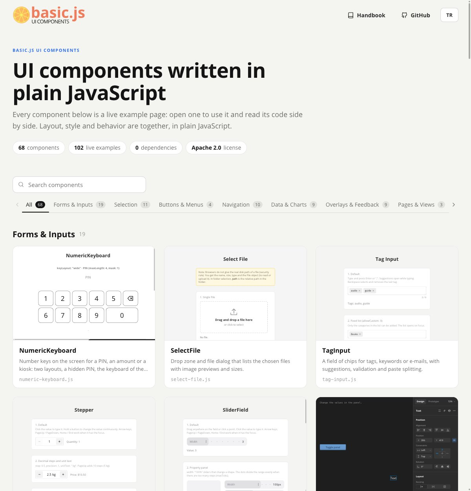

# JS-Component Kit

> **Design with code. See it work right away.**
> UI components, samples and app templates for building web interfaces in plain JavaScript, with layout, style and behavior in one place.

JS-Component Kit is built on [**basic.js**](https://bug7a.github.io/basic.js/), a small, dependency-free library that creates DOM objects directly from JavaScript. You add a `<script>` tag, write a few lines and open the page in a browser.

**[Browse the components](https://bug7a.github.io/js-components/)** · **[Handbook](https://bug7a.github.io/basic.js-handbook/)** · **[basic.js](https://bug7a.github.io/basic.js/)**

[](https://bug7a.github.io/js-components/)

---

## A Quick Look

```html
<link rel="stylesheet" href="basic/basic.min.css">
<script src="basic/basic.min.js"></script>
<script src="comp/smart-button.js"></script>

<script>
const start = function () {

    VGroup({ align: "center", gap: 16 });

        Label({ text: "Hello!", fontSize: 24 });

        SmartButton({
            width: 200,
            height: 50,
            labelText: "Click Me",
            iconFile: "assets/icons/alert-black.png",
            onClick: function (self) { println("Clicked"); },
        });

    endGroup();
};
</script>
```

When the page loads, basic.js creates the global `page` and calls `start()`. Every object you create goes into the current container, and `VGroup` … `endGroup()` lays those objects out vertically with flexbox.

---

## What Is Inside

Nearly 70 components. Every one has a live example with its code in the [component catalog](https://bug7a.github.io/js-components/).

| Group | Some of the components |
| :--- | :--- |
| **Forms and inputs** | `InputB` and its email, password, phone, number, currency and URL versions, `TextareaB`, `TagInput`, `Stepper`, `SliderField`, `RichTextEditor`, `Form` |
| **Selection** | `SelectBox`, `Filters`, `SelectDate`, `SelectTime`, `SelectColor`, `SelectFile`, `CheckBox`, `RadioButton`, `Toggle` |
| **Buttons and menus** | `SmartButton`, `HoldToConfirmButton`, `ContextMenu` |
| **Navigation** | `Tabs`, `Breadcrumbs`, `LeftMenu`, `BottomBar`, `PageControl` |
| **Data and charts** | `SmartTable`, `GraphBox`, `Gauge`, `SparkLineBox`, `ProgressBar`, `TimeLine`, `SortableList` |
| **Overlays and feedback** | `Dialog`, `SidePanel`, `Toast`, `Tooltip`, `LoadingScreen` |
| **Pages and views** | `LoginPage`, `WebView`, `PropertyPanel`, `LabelEditor` |

---

## Why JS-Component Kit?

* **Readable code:** The code for a screen follows the layout of the screen, so you can understand it at a glance.
* **Small learning curve:** If you know JavaScript, a handful of concepts are enough to start: `Box`, `Label`, `Button`, `AutoLayout` and `that`.
* **One place for everything:** You define layout, style and behavior together in JavaScript, so everything about a screen is in one place.
* **Lightweight:** The library and the components have no dependencies, and they work directly on the DOM.
* **Fast prototyping:** It suits solo developers and small teams who want to go from idea to working interface quickly.

---

## Key Features

### Self-Contained Components
Each component carries its own logic and styling. You create one with a single call and a props object, and change it later through explicit `setX()` methods.

### AutoLayout
AutoLayout wraps CSS flexbox in designer-friendly props such as `flow: "vertical"`, `align: "center top"`, `gap` and `padding`.

### Simple Motion
To animate an object, declare its transitions once with `obj.setMotion("left 0.3s, opacity 0.2s")` and then change its properties.

### Style Packages
The newer components come with ready-made looks. Pick one with `styleName` (`Tabs({ styleName: "modern" })`; most have `classic`, `modern` and `dark`), and change single values with the `style` prop.

### Theming (optional)
`comp/ui-standards.js` adds the global `UI`: color and size tokens (`UI.COLOR_SURFACE`, `UI.COLOR_PRIMARY`, `UI.ROUND_*`…) that keep the same name in every theme, and `UI.setTheme("light" | "dark" | "auto")` to switch. The components don't need it; use it for the colors of your own pages.

---

## Getting Started

A new project, ready to build with AI tools:

```sh
npm create basicjs@latest my-app
```

To work in this repository:

1. Clone or download this repository.
2. Open any `.htm` file in a browser. Many pages load images or other local files, so a local server works best. The VS Code **Live Server** extension is preconfigured on port `5505`.
3. For a new page, start from `_empty-project-template.htm`. For a new component, start from `_component-template.js`.

Load scripts in this order: `basic.css` and `basic.js` first, then `ui-standards` if you use it, then the components, then your page code.

### Using the components in your own project

Create your project folder in `_projects/` (copy `_projects/my-first-project/`) and load what you need with relative paths (`../../basic/…`, `../../comp/…`). When it is ready to leave the repository, run:

```sh
./_make-standalone.sh _projects/my-project
```

Your project folder is not changed: a ready copy is made in `_dist/my-project/`, with the library (`basic/`) and every component your pages load in one file (`comp/components.min.js`), and its paths rewritten, so that folder works on its own. Run it again after a change to make the copy again. `--out <folder>` puts it somewhere else, `--separate` makes one `.min.js` for each component.

### `.min` files

The library has `.min` twins (`basic.min.js`, `basic.min.css`, `scroll-bar.min.js`). After you edit one of their sources, rebuild its twin:

```sh
./_make-min-js.sh --build basic/basic.js
```

The components have no twins: pages load their source files, and `_make-standalone.sh` makes the minified file of a copy. `_make-template-repo.sh` makes the ready copies of the mobile templates for their own repository.

Both scripts use [terser](https://terser.org/) through `npx`, so they need Node.js. Nothing else in the repository does.

---

## Repository Structure

| Path | Contents |
| :--- | :--- |
| `basic/` | The core library (`basic.js`, `basic.css`, fonts) |
| `comp/` | All the components, in one folder |
| `index.htm`, `index/` | The component catalog site |
| `01-basic-js-by-example/` | Step-by-step tutorial pages for the core library, written for beginners |
| `01-basic-js-by-example/_first-coding-projects/` | Small projects for people who write their first programs (calculator, dice, XOX, snake, chess…), each with notes on its algorithm |
| `02-comp-examples/` | Demo pages of the components |
| `03-webpages/` | Web sites drawn with basic.js: the library site and the handbook site |
| `04-templates/` | App templates: [mobile apps](04-templates/mobile-app-template/) (a shop, bookings, a coffee shop and a starter frame), admin panel, web forms (contact, appointment, order…), a to-do app, and `easy-pwa`, a script that turns a site into an installable app |
| `_projects/` | Your own projects: copy `my-first-project/` and use `basic/` and `comp/` from the repository (see its readme) |
| `05-showcase/` | Links to live apps made with basic.js |
| `__handbook/` | The basic.js handbook in [English](__handbook/english/) and [Turkish](__handbook/turkce/) |
| `context/` | Short reference docs for the core library and components, written for AI assistants |
| `__developer-toolkit/` | VS Code extensions for basic.js: completer, object navigator, view inspector |
| `_basic-designer/` | A visual editor for basic.js pages, with a VS Code extension (alpha): `vscode-extension/` |
| `test/` | Self-checking test pages for basic.js and the components (open one, the tab title says ALL PASS) |
| `assets/` | Images shared by the samples |

---

## How It Works

| | |
| :--- | :--- |
| **Language** | Plain JavaScript |
| **Styling** | Defined on the object |
| **Running** | Save the file and open the page in a browser |
| **Dependencies** | None |
| **Search engines** | The page is drawn by JavaScript; content for crawlers is added by hand |
| **Ecosystem** | One library and this repository |

It fits admin panels, dashboards, internal tools, forms, mobile apps and prototypes written by one developer or a small team. For a content site that lives on search traffic, or a large team that needs a framework's conventions and a wide ecosystem, a framework is the better choice.

---

## Built with This Technology

* **UI Components:** [Browse Components](https://bug7a.github.io/js-components/)
* **Mobile App Templates:** [Shop, booking, coffee shop, starter and classic](04-templates/mobile-app-template/)
* **Mobile App on Web:** [Expense Showcase App](https://bug7a.github.io/expense/)
* **PC Games on Steam:** [The Fallen Kingdoms](https://store.steampowered.com/app/2923920/), [Fishing Company Tycoon](https://store.steampowered.com/app/5452400/Fishing_Company_Tycoon_Harbor_to_Market/)

---

## License

Copyright 2020-2026 Bugra Ozden <bugra.ozden@gmail.com>
Licensed under the [Apache License, Version 2.0](LICENSE).
